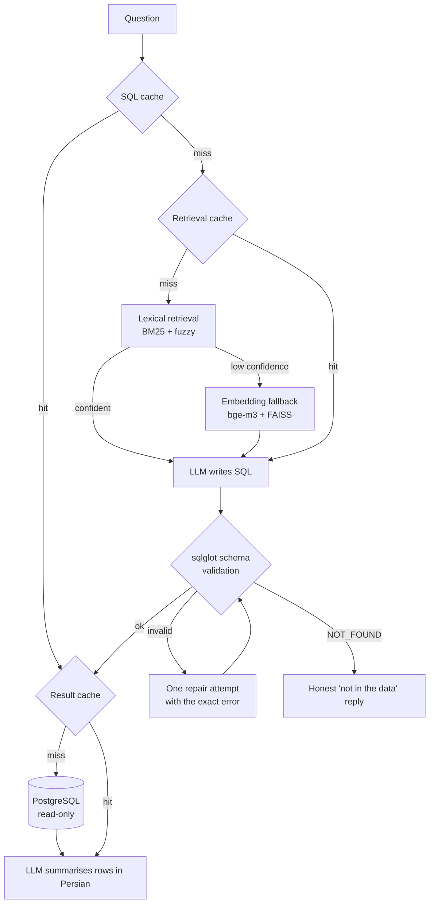

# Persian Text-to-SQL

[فارسی](README.fa.md)

Ask a question about an online-store database **in Persian**, get an answer **in Persian**. A local LLM (Ollama, `qwen3:8b`) writes the SQL; the SQL is checked against the schema, executed read-only on PostgreSQL, and the rows are summarised back in natural language. A FastAPI service and a Telegram bot sit on top.

Everything runs locally. No external API calls.

```
You:  مجموع مبلغ خرید هر مشتری چقدر است؟ ۱۰ مشتری برتر را نشان بده.
Bot:  (top-10 customers by total spend, summarised in Persian)
SQL:  SELECT c.first_name, c.last_name, SUM(oi.quantity * oi.unit_price) ...
```

## How it works



**1. Schema retrieval, two stages.** Sending the whole schema to a small model hurts accuracy, so only relevant tables are retrieved. Stage one is lexical (BM25 + fuzzy matching over table/column names and Persian descriptions): pure stdlib, ~50 ms, no model load. Only if its top score is below `LEXICAL_CONFIDENCE_THRESHOLD` (default `0.35`) does it fall back to embeddings (`BAAI/bge-m3`) + FAISS. The embedding model and index are loaded lazily, on the first fallback only.

**2. SQL generation with a "can't answer" exit.** The prompt includes a worked schema-linking → join-path → fan-out example. If the retrieved schema cannot answer the question, the model must reply `NOT_FOUND: <reason>` instead of inventing a query.

**3. Deterministic validation.** Generated SQL is parsed and qualified with [sqlglot](https://github.com/tobymao/sqlglot) against *only the tables that were retrieved*. A hallucinated table or column is caught before the database sees it, and the exact error is sent back to the model for one repair attempt.

**4. Read-only execution.** Only a single `SELECT`/`WITH` statement is allowed; writes and DDL are rejected, the transaction is `READ ONLY`, rows are capped at 200, and connections come from a pool.

**5. Three caches** (SQLite, `data/state/cache.db`):

| Cache | Key | Saves | TTL |
|---|---|---|---|
| sql | normalised question | retrieval + generation + validation | 7 days |
| retrieval | normalised question | embedding / FAISS | 7 days |
| result | SQL hash | PostgreSQL round trip | 5 min |

Only SQL that passed validation is cached. The final natural-language answer is deliberately **not** cached, since it is phrased for the exact question.

## Measured performance

From the harness in `benchmarks/` (5 questions × 5 runs; `qwen3:8b` via Ollama on a VRAM-limited consumer GPU with part of the model on CPU: ~2.8 GB VRAM used, ~10 tokens/s). Raw data: `benchmarks/results/`.

| Stage | Avg time |
|---|---|
| Schema retrieval | 0.03–0.08 s (0.62 s when it falls back to embeddings) |
| SQL generation | 1.8–11.8 s depending on query complexity |
| SQL execution | < 0.01 s |
| **Answer generation** | **2.2–28 s** |

- **Lexical retrieval resolved 80 % of requests (20/25)** without touching the embedding model. The 5 fallbacks were the one deliberately out-of-scope question (confidence 0.06).
- **Answer generation, not SQL, is the bottleneck.** It's the longest stage and is not cached, so the cache benchmark shows only a **1.3× median speedup** (19.2 s cold → 14.6 s warm); the best case (a filter question) was 3.6×. Skipping retrieval and SQL generation helps, but the LLM still has to write the answer.
- One of the 25 runs of the hardest question (top-10 aggregation) ended in an error.

There is no execution-accuracy evaluation yet (see [Limitations](#limitations)).

## Quick start

Python ≥ 3.10, PostgreSQL, and [Ollama](https://ollama.com).

```bash
python -m venv .venv && source .venv/bin/activate
pip install -r requirements.txt

cp .env.example .env            # fill in PG_* and (optionally) TOKEN

# PostgreSQL: create the user/db that match .env, then load the sample data
psql -U postgres -c "CREATE USER textsql WITH PASSWORD 'change-me';"
psql -U postgres -c "CREATE DATABASE online_store OWNER textsql;"
python db_setup/load_data.py --host localhost --user textsql --password change-me --db online_store

ollama pull qwen3:8b

# Ask from the command line
python scripts/ask.py "چند سفارش در وضعیت لغو شده هستند؟"

# Or run the API (+ the Telegram bot in a second terminal)
uvicorn api.main:app --host 0.0.0.0 --port 8000
python -m api.bot.chatBot
```

`data/metadata/` and `data/vector_db/` are already generated for the sample schema. If you change the schema, regenerate them:

```bash
python scripts/build_metadata.py --host localhost --user textsql --password change-me --db online_store
python scripts/build_embeddings.py
```

The first embedding fallback downloads `BAAI/bge-m3` from HuggingFace unless `EMBEDDING_MODEL_PATH` points at a local copy.

### API

| Method | Path | |
|---|---|---|
| `POST` | `/question` | `{"telegram_id": 1, "question": "…"}` → `{"answer": "…", "sql": "…"}` |
| `GET` | `/history/{telegram_id}` | past questions of a user |
| `GET` | `/health` | Ollama + request-log status |

```bash
curl -X POST localhost:8000/question -H 'Content-Type: application/json' \
  -d '{"telegram_id": 1, "question": "پرفروش‌ترین محصول چیست؟"}'
```

Every request is logged in SQLite as `pending → done / error / not_found`. A second request from the same user while one is still running gets `409`, and the blocking pipeline runs in a worker thread so one slow question doesn't freeze the others. Interactive docs are at `/docs`. The Telegram bot supports `/start`, `/help` and `/question`.

### Configuration

Everything is a `pydantic-settings` field in `app/core/config.py` and can be overridden in `.env` (see `.env.example`): PostgreSQL, Ollama model/URL, `LEXICAL_CONFIDENCE_THRESHOLD`, cache TTLs, `NUM_CTX`, `NUM_GPU`, CORS, and more.

## The sample dataset

An online store in Persian: `categories`, `customers`, `products`, `orders`, `order_items`, `reviews` (≈2,500 rows total; CSVs in `data/csv-data/csv/`, DDL in `db_setup/schema.sql`).

## Tests

```bash
python -m unittest discover -s tests -t . -v
```

37 tests, no Ollama and no model download needed:

| File | Covers |
|---|---|
| `test_lexical_retriever`, `test_schema_retriever` | two-stage retrieval, threshold, lazy loading, fallback against the real FAISS index |
| `test_pipeline` | full pipeline with scripted LLM: cache hits, repair loop, `NOT_FOUND`, hallucinated columns, write attempts |
| `test_api` | FastAPI endpoints, 409 guard, stale-pending reset, error handling |
| `test_postgres_integration` | real PostgreSQL (auto-skipped if unavailable): results match the source CSVs, writes blocked |
| `test_answer_router` | `AnswerRouter` |

## Benchmarks

```bash
python -m benchmarks.run_benchmark          # per-stage timing, CPU/RAM/GPU sampling, retrieval method split
python -m benchmarks.run_cache_benchmark    # cold vs warm, paraphrase hits, per-cache isolation
python -m benchmarks.report benchmarks/results/run_YYYYMMDD_HHMMSS.jsonl   # report + plot from a run
```

Needs live PostgreSQL and Ollama. See `benchmarks/README.md`.

## Project layout

```
api/            FastAPI app, request log (SQLite), Telegram bot
app/
  embeddings/   lexical + embedding retrieval, FAISS store
  llm/          prompts, Ollama client, SQL generator, sqlglot validator, answer generator
  cache/        SQLite KV store + the three caches
  db/           read-only PostgreSQL executor (pooled)
  routing/      AnswerRouter (not wired into the pipeline yet)
  pipeline.py   ties it all together
benchmarks/     instrumented pipeline, resource sampler, reports, results/
data/           csv-data, metadata, vector_db, state (git-ignored *.db)
db_setup/       schema.sql + loader
scripts/        ask.py, build_metadata.py, build_embeddings.py, clear_cache.py
tests/
```

## Limitations

- **Small, single schema** (6 tables). Lexical retrieval is tuned to this schema's Persian vocabulary; a different domain will need its own descriptions in `data/metadata/descriptions/` and a re-tuned threshold.
- **No accuracy benchmark.** Benchmarks measure speed and resource use; whether the SQL is *correct* is not measured yet. Schema validation guarantees identifiers exist, not that the query means what the user asked.
- **Slow on modest hardware**, mostly because of answer generation (see numbers above).
- `AnswerRouter` (decide when a question needs LLM analysis vs. a plain table) exists and is tested, but isn't connected to the pipeline.
- Persian only; the prompts are in Persian.
- Run with a single worker (`--workers 1`): the model/index live in process memory.

## Security notes

- Never commit `.env`; it's git-ignored. If a Telegram token ever leaves your machine, regenerate it with @BotFather.
- Defaults (`PG_PASSWORD=123456`, `CORS_ORIGINS=*`) are for local development only. Change them before exposing the API.
- SQL safety rests on the executor's checks plus the read-only transaction; use a PostgreSQL user that only has `SELECT` rights.
